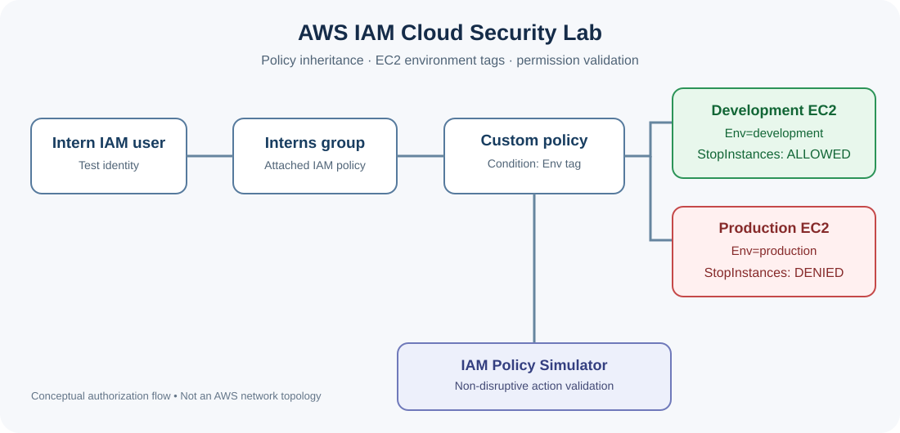
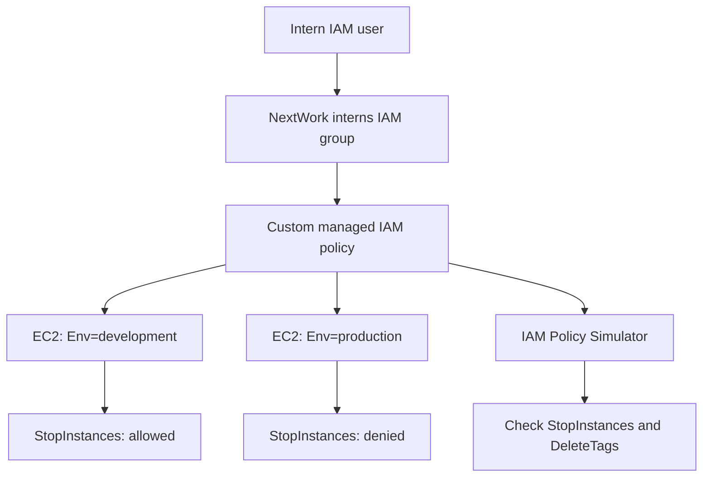

# AWS IAM Cloud Security Lab — Least Privilege & EC2 Access Control

**AWS IAM · Amazon EC2 · JSON policies · Tag-based access control · IAM Policy Simulator**

## Overview

I completed a hands-on cloud security lab in AWS to control what an intern account can do in separate **development** and **production** environments. I launched two EC2 instances, configured a custom IAM policy, attached it to an intern user group, and signed in as the IAM user to test the permissions.

**Key outcome:** The intern account successfully initiated a stop operation on the development EC2 instance, but AWS denied the same operation on the production instance. I then used the IAM Policy Simulator to validate policy behavior without changing live resources.

This lab was completed through [NextWork's Cloud Security with AWS IAM project](https://nextwork.ai/projects/51a5fd24-7458-58a6-8653-9b90119a0e4a).

## Architecture and access model



**Diagram explanation:** The test intern belongs to the interns IAM group, which receives the custom policy. The policy uses EC2 resource tags to allow the tested stop action in development, while the same production action is not allowed. The IAM Policy Simulator independently validates selected policy decisions. This is an authorization diagram, not a network topology diagram.



The EC2 instances were organized with environment tags, using the key `Env` and values `development` and `production`. The IAM policy evaluated resource tags when granting access. The exact capitalization of tag keys matters in AWS.

## Services and security concepts

| Service / concept | How I used it |
| --- | --- |
| **Amazon EC2** | Deployed a development instance and a production instance to test environment-specific permissions. |
| **AWS IAM** | Created an intern IAM user and group, then assigned permissions through the group. |
| **Custom JSON IAM policy** | Controlled EC2 access using allow/deny statements and an `ec2:ResourceTag/Env` condition. |
| **Account alias** | Configured a friendlier IAM console sign-in URL. |
| **IAM Policy Simulator** | Checked access decisions without stopping running instances. |
| **Least privilege** | Limited the intern's tested operational access to development rather than production. |

## What I implemented

1. **Created two EC2 instances:** one for development and one for production.
2. **Tagged resources by environment:** `Env=development` and `Env=production`.
3. **Created a custom IAM policy:** provided EC2 access when the resource's `Env` tag matched `development`, allowed EC2 describe operations, and explicitly denied tag creation and deletion.
4. **Created a group and user:** attached the policy to an intern IAM group and added the test intern IAM user to that group.
5. **Configured an AWS account alias:** simplified the AWS console sign-in URL for IAM users.
6. **Tested the policy:** signed in as the intern, attempted to stop each instance, and recorded the different results.
7. **Used the Policy Simulator:** tested `ec2:StopInstances` and `ec2:DeleteTags` without modifying live instances.

## Step-by-step implementation

### Step 1 — Deploy and label the test environments

I launched **two Amazon EC2 instances** to represent separate NextWork workloads: one for development and one for production. I added an environment tag to each resource—`Env=development` for the development instance and `Env=production` for the production instance. Tags make it possible to write resource-aware IAM conditions, rather than granting a new intern broad control over every EC2 instance.

**What this demonstrates:** EC2 resource administration, environment separation, and the role of resource tags in security policy evaluation. The instance types and networking settings were not the security boundary tested in this lab; the IAM policy was.

### Step 2 — Build the custom JSON permission policy

I created **`NextWorkDevEnvironmentPolicy`** with three core behaviors. First, an allow statement uses the condition `StringEquals` on `ec2:ResourceTag/Env` so a matching development-tagged resource can be managed by the allowed EC2 actions. Second, a separate `ec2:Describe*` allow enables EC2 inventory visibility. Third, an explicit deny blocks `ec2:CreateTags` and `ec2:DeleteTags`, reducing the risk of a user changing the environment labels that the policy depends on.

**What this demonstrates:** `Effect`, `Action`, `Resource`, `Condition`, and the distinction between **implicit deny** (nothing allows it) and **explicit deny** (a matching deny statement blocks it). This project's example policy uses `ec2:*` under a condition; that is **broader than a production-grade least-privilege policy** and would need tighter scoping before real deployment.

### Step 3 — Set an AWS account alias

I configured an AWS account alias to provide a friendlier IAM-console sign-in URL. An account alias makes it easier for IAM users to locate the correct AWS sign-in page; it **does not grant any permissions**. Authentication and IAM authorization are still separate controls.

### Step 4 — Create the intern user and IAM group

I created a dedicated IAM group for NextWork interns, attached the custom policy to the **group**, and added the new intern IAM user as a member. This lets administrators update permissions for the group rather than attaching identical policies to every intern individually.

**What this demonstrates:** Centralized permissions and inheritance through group membership. The user should be granted only the console access needed for the learning scenario, and their credentials should be handled securely.

### Step 5 — Verify console access as the intern

I signed in using the test intern's IAM identity. Some dashboard panels showed **Access denied** because the account did not have every permission needed by the console. This is consistent with restricting a user to a limited collection of AWS actions: the console can render while individual API requests are denied.

### Step 6 — Test authorization against live EC2 resources

From the intern session, I tried the **same EC2 stop operation** on each environment. AWS denied stopping production with an authorization error, while initiating a stop for the development instance. Because the development instance actually entered `Stopping`, I learned that live permission checks can disrupt real workloads. The screenshots below show both outcomes.

### Step 7 — Validate selected permissions with the Policy Simulator

Finally, I ran a non-disruptive simulation for `ec2:StopInstances` and `ec2:DeleteTags`, providing the resource-tag condition `ec2:ResourceTag/Env = development`. The simulator allowed **StopInstances** and denied **DeleteTags**. This was safer than repeating the live EC2 stop test. The simulator screenshot shows a development condition; the production denial was verified by the live console error rather than a separate production simulator run.

For a test-by-test record, see [`tests/permission-validation.md`](tests/permission-validation.md).

### IAM policy reference

A reconstructed, readable example based on the policy shown in my simulator screenshot is in [`policies/NextWorkDevEnvironmentPolicy-example.json`](policies/NextWorkDevEnvironmentPolicy-example.json). It reflects the actions and conditions documented in this lab, but **it is not an exported policy file and should be reviewed before reuse**.

Important behavior:

- The `StringEquals` condition checks `ec2:ResourceTag/Env = development` for the tagged-resource allow statement.
- `ec2:Describe*` supports listing and inspecting EC2 resources.
- Explicit `Deny` statements for `ec2:CreateTags` and `ec2:DeleteTags` prevent changing tags even when another statement would otherwise allow those actions.
- A production stop attempt was **implicitly denied** because no applicable identity-based policy allowed `ec2:StopInstances` on the production resource. That differs from the **explicit deny** on tag changes.

> **Scope note:** The lab policy uses `ec2:*` subject to a development-resource tag condition. That is broader than a production-grade least-privilege policy. In a real environment, I would replace `ec2:*` with a narrow list of required actions, review action-level resource support, and validate the complete permission boundary.

> **Screenshot note:** Three redacted evidence images are in the project ZIP prepared in this chat but have not yet been uploaded to GitHub. Upload them to `screenshots/` separately to enable inline evidence here.

## Validation and results

| Test | Method | Observed result |
| --- | --- | --- |
| Stop development EC2 instance | IAM user in AWS console | **Allowed** — instance changed from `Running` to `Stopping`. |
| Stop production EC2 instance | IAM user in AWS console | **Denied** — AWS reported the user was not authorized for `ec2:StopInstances`. |
| Simulate `ec2:StopInstances` with `Env=development` | IAM Policy Simulator | **Allowed**. |
| Simulate `ec2:DeleteTags` | IAM Policy Simulator | **Denied** by matching policy statement. |

### 1. Production instance — stopping denied

_Screenshot available in the project package; upload `screenshots/01-production-stop-denied.png` to display the redacted console evidence here._

The intern's attempt to stop the production EC2 instance returned an authorization error. This verified that the policy did not permit the tested production operation.

### 2. Development instance — stopping allowed

_Screenshot available in the project package; upload `screenshots/02-development-stop-allowed.png` to display the redacted EC2 confirmation here._

AWS initiated a stop operation on the development instance. The screenshot also shows the production instance remaining in a running state.

### 3. IAM Policy Simulator — permission validation

_Screenshot available in the project package; upload `screenshots/03-iam-policy-simulator.png` to display the redacted simulation result here._

In the simulator, I set `ec2:ResourceTag/Env` to `development`. The `StopInstances` action was allowed and `DeleteTags` was denied. This was a safer way to check these actions than repeating disruptive operations on live instances. **This screenshot does not show a separate simulation of production's stop permission; that outcome was demonstrated by the actual console test above.**

## Security lessons learned

- **IAM groups centralize permission administration.** Assigning permissions to the intern group reduces the need to manage each user's policy separately.
- **Resource tags can drive access decisions.** The development/production boundary was based on matching an EC2 resource tag.
- **Explicit and implicit denies are different.** The production stop lacked an applicable allow; tag modification was directly blocked by explicit deny statements.
- **Testing permissions can affect workloads.** The live test stopped the development EC2 instance, so the Policy Simulator is preferable for routine validation.
- **Console visibility is not the same as modification access.** Describe permissions can allow a resource to appear in the console without granting permission to stop it.

## Project reflection

**Time to complete:** Approximately **1 hour and 30 minutes**.

The most challenging part was writing a JSON IAM policy that allowed the intended development actions while preventing changes to the production environment, and understanding how tag-based conditions and explicit deny statements interact.

The most rewarding part was testing the same EC2 operation against both environments and seeing **allowed** for development and **denied** for production. I also learned how to test permissions more safely through the IAM Policy Simulator.

## Future improvements

- Replace broad `ec2:*` authorization with specific actions needed by an intern.
- Evaluate IAM Identity Center and MFA for workforce sign-in.
- Simulate additional production actions and document their results.
- Add CloudTrail-based auditing of policy and EC2 API activity.

## Repository contents

```text
aws-iam-cloud-security-lab/
├── README.md
├── .gitignore
├── architecture/
│   └── aws-iam-access-control.svg
├── policies/
│   └── NextWorkDevEnvironmentPolicy-example.json
└── tests/
    └── permission-validation.md
```

---

**Project:** [Cloud Security with AWS IAM — NextWork](https://nextwork.ai/projects/51a5fd24-7458-58a6-8653-9b90119a0e4a)  
**Author:** Kelvin Westbrook II

*Screenshots have been trimmed or redacted to reduce exposure of AWS identifiers and sign-in details. Do not publish temporary passwords, access keys, account IDs, or unreviewed authorization messages.*